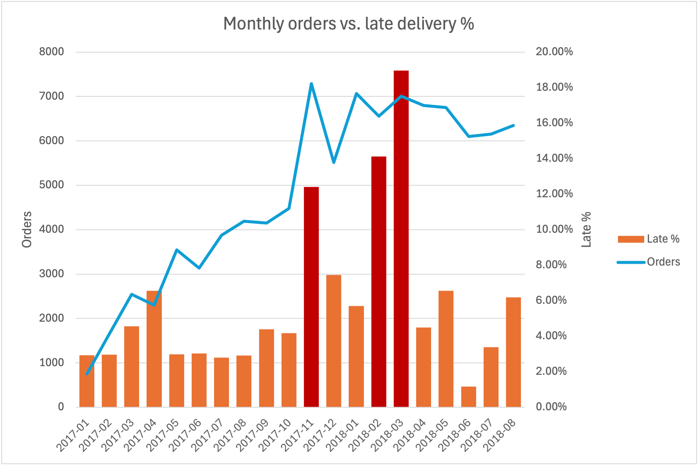
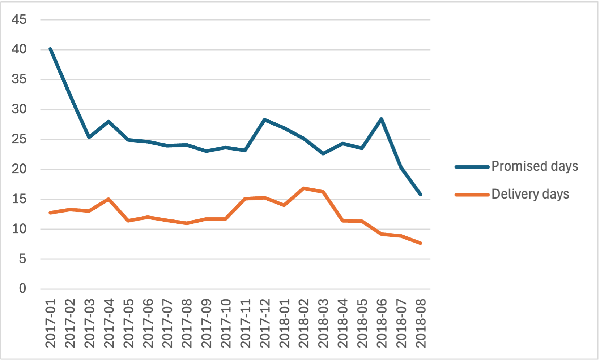

# Late Deliveries in Brazilian E-Commerce (96K Real Orders)

Where and when do online orders arrive late, and how much does it cost in customer reviews?

**[View the interactive Tableau dashboard](https://public.tableau.com/views/OlistLateDeliveriesDashboard/OlistDeliveryDashboard)**

**Key findings**
- Late orders (6.8% of 96K) average **2.3 stars vs. 4.3** for on-time orders.
- The Northeast and Rio de Janeiro run about **2x** the national late rate.
- **3 months** (Black Friday 2017, Feb–Mar 2018) produce nearly **half** of all late orders.
- Root cause: deliveries slowed nationwide, but promises didn't adjust. When the cushion between promised and actual days dropped below about 10 days, late % spiked.

## Problem
Late deliveries hurt customer satisfaction and repeat business. I wanted to measure three things for a real marketplace:
1. How much lateness drags down review scores
2. Which regions get the most late orders
3. Which months it gets worse

## Data
- **Source:** [Brazilian E-Commerce Public Dataset by Olist](https://www.kaggle.com/datasets/olistbr/brazilian-ecommerce) (Kaggle). Real anonymized orders from 2016–2018.
- **Tables used:** orders, customers, order reviews, order items
- **Scope:** 99,441 orders total. I kept the **96,470 delivered orders** and excluded 2,971 that were canceled, unavailable, or never delivered. The monthly view also leaves out 267 orders from 2016, because there's too little data there.

## Approach (Excel)
1. Cleaned the orders table: removed non-delivered orders and orders with no delivery date.
2. Built calculated columns:
   - `delivery_days`: purchase to delivery
   - `late_flag`: 1 if delivered after the promised date (compared by date only, so a same-day delivery isn't counted late)
   - `days_late`: how many days past the promise
3. Joined the other tables:
   - **XLOOKUP** for customer state and review score
   - **SUMIFS** for order totals (price and freight), since one order can have several items
4. Added `promised_days` (purchase to promised date) to compare the promise with actual delivery.
5. Built pivot tables by review outcome, state, month, and state within Feb–Mar 2018, plus charts for the monthly trend.

## Findings

### 1. Late orders lose about 2 stars
| | Orders | Avg review |
|---|---|---|
| On time | 89,936 | **4.29** |
| Late | 6,534 (**6.8%**) | **2.27** |

Only about 1 in 15 orders arrives late, but those orders score almost half as well. Lateness is one of the biggest drivers of bad reviews.

### 2. The Northeast and Rio de Janeiro run about 2x the national late rate
| State | Orders | Late % | Avg delivery days |
|---|---|---|---|
| AL | 397 | 21.4% | 25 |
| MA | 717 | 17.4% | 22 |
| SE | 335 | 15.2% | 21 |
| PI | 476 | 13.9% | 19 |
| CE | 1,279 | 13.8% | 21 |
| RJ | 12,350 | 12.1% | 15 |
| **SP (benchmark)** | **40,494** | **4.5%** | **9** |

- The 9 Northeast states together run about **12.7% late**, versus 6.8% nationally.
- **RJ is the biggest problem by count:** about 1,500 late orders, nearly a quarter of all late deliveries. It sits right next to São Paulo, so distance doesn't explain it.
- **Far doesn't automatically mean late.** Far-north states (AM, AP, RO) average 26–27 days but are only about 3% late, because their delivery promises are longer. Lateness is about *promise accuracy*, not just distance.

### 3. Nearly half of all late orders come from 3 months
- **Nov 2017 (Black Friday):** the highest-volume month (7,288 orders), and late % jumped from about 4% to **12.4%**.
- **Feb and Mar 2018:** **14.1% and 19.0%** late. January 2018 had similar volume and was only 5.7% late, so volume alone doesn't explain these months.
- Together, these 3 months account for about 3,100 of the 6,534 late orders.

### 4. Why Feb–Mar 2018 broke: delivery slowed, but the promise didn't adjust
**It was nationwide, not regional.** Every state's late rate rose about 2–3x in Feb–Mar 2018. Even São Paulo, the best performer, went from 4.5% to 8.4%. RJ hit 34%.

**Comparing the promise to the actual delivery shows what happened:**
| Month | Promised days | Actual days | Cushion | Late % |
|---|---|---|---|---|
| Typical 2017 | ~24 | ~12 | ~12 | 3–4% |
| Nov 2017 | 23 | 15 | 8 | 12.4% |
| Dec 2017 | 28 | 15 | 13 | 7.5% |
| Jan 2018 | 27 | 14 | 13 | 5.7% |
| **Feb 2018** | **25** | **17** | **8** | **14.1%** |
| **Mar 2018** | **23** | **16** | **7** | **19.0%** |
| Apr 2018 | 24 | 11 | 13 | 4.5% |

- From Nov 2017 to Mar 2018, actual delivery times stayed **3–5 days slower** than normal.
- In Dec–Jan, longer promises **absorbed the slowdown**, and late % stayed low.
- In Feb–Mar, promises went back to normal while deliveries were **still slow**. The cushion shrank from about 13 days to 7–8, and late % spiked.
- The pattern holds across months: **when the cushion drops below about 10 days, late % jumps.**

So the problem wasn't bad promises in general. Promises didn't keep up with a network that was running slower.

## Recommendations
1. **Plan for peak.** Add carrier capacity or lengthen delivery promises before Black Friday and other known peaks.
2. **Set promises by region.** Use the approach that already works in far-north states for the Northeast: promise what the network can actually deliver.
3. **Investigate RJ first.** It's the largest pool of late orders, and it's close to the main seller base. That points to a carrier or last-mile problem, not distance.
4. **Make promises adjust to real delivery times.** Track the cushion (promised minus actual days) weekly. When actual delivery times rise, extend promises so the cushion stays at about 10+ days. This is what happened in Dec–Jan, and it worked.
5. **Track late % and the cushion together as KPIs.** The cushion is the early warning: it started shrinking before late % spiked.

## Limitations
- The "late" definition depends on Olist's estimated delivery date. If that estimate changed over time, late % would shift even if service didn't.
- The last months (Jun–Aug 2018) probably look better than they were. Orders still in transit when the data was pulled were excluded, and those are the ones most likely to be late.
- A few orders have two reviews (I used the first) or no review at all.
- I can't see *why* delivery slowed from Nov 2017 to Mar 2018 (carrier capacity, seller dispatch delays, etc.). A brief national postal strike in mid-March 2018 may have added to March, but it can't explain February.
- The Jan–Feb 2017 promised days (32–40) are unusually high and are based on low early volume.

## Next steps
- Split delivery time into seller dispatch (purchase → carrier) vs. carrier transit (carrier → customer) to see which part slowed down
- Freight cost as % of order value by region
- Rebuild the analysis in SQL and as a Tableau Public dashboard with a map

## Files
- `olist_analysis_github.xlsb`: Excel workbook with the cleaned orders table and all pivots (saved as .xlsb to stay under GitHub's size limit; opens in Excel)
- `late_by_month.png`, `promised_vs_actual.png`: charts used above

## Tools
Excel: XLOOKUP, SUMIFS, pivot tables, PivotCharts (combo chart with secondary axis)
